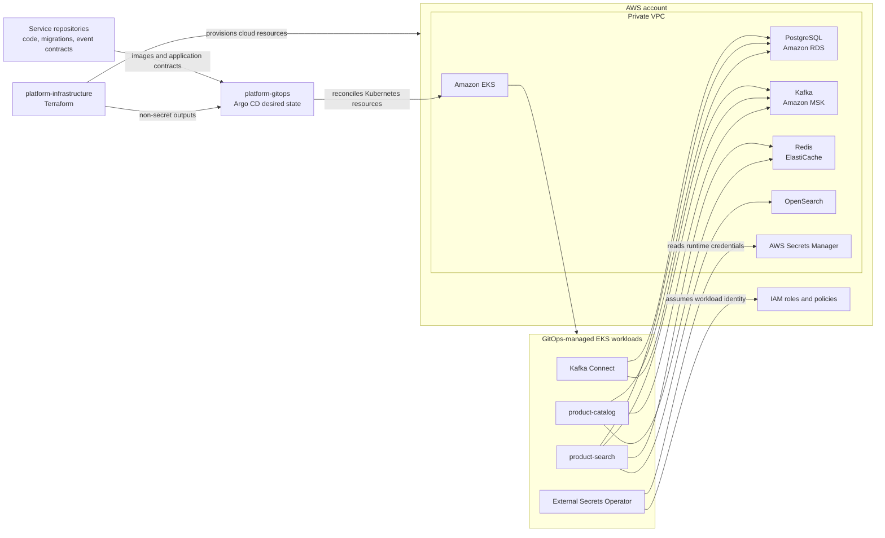

# Platform Infrastructure

Terraform infrastructure-as-code and local development configuration for the
Product Catalog platform. This repository provisions AWS foundations and
managed services while supporting AWS-independent local development.

> **Deployment status:** Configuration in this repository does not mean that
> cloud resources or workloads have been created. Terraform operations and
> production deployment are explicit operator actions. Follow the
> [deployment runbook](DEPLOYMENT.md).

> **Ownership boundary:** This repository owns cloud infrastructure.
> [platform-gitops](../platform-gitops) owns Argo CD and Kubernetes desired
> state; service repositories own application behavior and data contracts.
> Before syncing a GitOps source, inventory any existing cluster ownership
> and complete a deliberate handoff.

## Architecture



### Resource ownership

| Owner | Responsibility |
| --- | --- |
| `platform-infrastructure` | Terraform-managed AWS foundations, networking, EKS infrastructure and AWS-managed add-ons, data services, IAM, secret storage, and infrastructure outputs. Local Compose configuration is also here. |
| `platform-gitops` | Argo CD projects/applications and Kubernetes desired state, including controllers installed by Helm, application workloads, External Secrets resources, policies, ingress, and rollout configuration. |
| Service repositories | Application behavior, APIs, tests, database migrations and schemas, event contracts, and service-specific instrumentation. |

Terraform may provision cloud identities and permissions for controllers
installed by GitOps, but must not manage the same Kubernetes resources as
Argo CD. Connector behavior and event semantics should remain coordinated
with the relevant service owner.

## Repository layout

| Path | Purpose |
| --- | --- |
| `.github/aws/` | Example GitHub Actions OIDC trust policy |
| `.github/workflows/` | Infrastructure validation, protected Terraform workflow, and Kafka Connect image publishing |
| `compose/` | Local PostgreSQL, Redis, Kafka, OpenSearch, Kafka Connect, and optional application Compose configuration |
| `connectors/` | Interim Debezium connector configuration for local development and operator registration |
| `scripts/` | Terraform state bootstrap, database/CDC bootstrap, GitOps handoff, and connector registration helpers |
| `terraform/` | One Terraform root for AWS foundations, managed services, IAM, observability, and outputs |
| `terraform/modules/database/` | PostgreSQL instance, subnet group, security group, and parameter group |
| `tests/` | Tests for infrastructure handoff helpers |
| `DEPLOYMENT.md` | Production prerequisites, bootstrap order, and operator commands |
| `OPERATIONS.md` | Monitoring, incident triage, and recovery exercises |

Kubernetes manifests and Argo CD configuration are maintained in
`platform-gitops`, not in this repository. Terraform currently has one root
composition; dev and staging GitOps values do not imply separate Terraform
environments.

The Debezium connector JSON and registration helper remain here for local
development and operator use until the product-catalog service repository
owns and publishes the connector configuration. The service remains the
authority for outbox schema and event semantics.

## Local development

Requirements: Docker Engine with Docker Compose v2. To start the dependencies
and applications, set a local-only PostgreSQL password and run from the
repository root:

```sh
export POSTGRES_PASSWORD='use-a-local-development-password'
docker compose \
  -f compose/compose.yml \
  -f compose/compose.apps.yaml \
  up --build
```

The application Compose file builds from sibling repositories at
`../../product-catalog` and `../../product-search` relative to the Compose
configuration. Clone those repositories beside this one to run the services.

| Service | Local endpoint |
| --- | --- |
| Product Catalog | `http://localhost:8080` |
| Product Search | `http://localhost:8081` |
| PostgreSQL | `localhost:5432` |
| Redis | `localhost:6380` |
| OpenSearch | `http://localhost:9200` |
| Kafka | `localhost:9092` |
| Kafka Connect REST | `http://localhost:8083` |

Use `docker compose ... logs -f <service>` to inspect a service and
`docker compose ... down` to stop the stack. Named volumes preserve local
PostgreSQL and OpenSearch data. The local OpenSearch security plugin is
disabled; do not expose it beyond a trusted development machine. Compose uses
development-oriented single-node services and is not a production deployment.

## AWS infrastructure

Terraform defines a three-AZ VPC, private EKS cluster and managed node groups,
private PostgreSQL RDS, three-broker Amazon MSK, encrypted Multi-AZ Redis, and
a private OpenSearch domain. It also configures AWS Secrets Manager access,
AWS-managed EKS add-ons, IAM roles, selected CloudWatch alarms, and a
dashboard.

The EKS API and data services are private. Terraform state is sensitive and
requires an encrypted, versioned S3 backend with restricted access and
locking. The managed-service architecture can incur substantial ongoing
costs; review sizing, availability, recovery objectives, and regional support
before deployment.

For state bootstrap, GitHub OIDC setup, Terraform initialization, deployment
ordering, credential bootstrap, GitOps handoff, and CDC prerequisites, follow
the [deployment runbook](DEPLOYMENT.md). For monitoring, incident response,
and recovery guidance, see [operations](OPERATIONS.md) and review the current
infrastructure details in [terraform/README.md](terraform/README.md).

## Validation and CI

The infrastructure GitHub Actions validate workflow checks YAML, Compose
configuration, connector JSON, shell/Python scripts, and Terraform formatting
and validation. Kubernetes/Helm and CDC manifest validation belongs to the
separate `platform-gitops` workflow. Terraform deployment is manual and uses
a protected production environment; Kafka Connect image publishing is handled
by its own workflow.

Available local checks that do not access a remote Terraform backend:

```sh
yamllint compose .github/workflows
POSTGRES_PASSWORD=validation-only-password \
  docker compose -f compose/compose.yml -f compose/compose.apps.yaml config --quiet
python3 -m json.tool connectors/postgres-outbox-connector.json >/dev/null
for file in scripts/*.sh; do bash -n "$file"; done
python3 -m unittest discover -s tests -v
git diff --check
```

Terraform validation and deployment prerequisites are documented in
[DEPLOYMENT.md](DEPLOYMENT.md). Do not initialize against a remote backend or
run a plan/apply without the required operator authorization and review.

## Known limitations

- The managed-service stack has significant cost; Terraform plan output is
  not a cost estimate.
- MSK client access is TLS-protected but does not currently require
  SASL/IAM authentication. OpenSearch fine-grained authentication is disabled.
- Application ingress is not provisioned by default. Public access requires
  a real domain, DNS, ACM certificate, and a GitOps-reviewed configuration.
- RDS automated backups are configured, but cross-region backup replication
  and automatic regional failover are not provisioned.
- Infrastructure alarms and log collection cover selected signals; complete
  application dashboards, tracing, alert ownership, and recovery objectives
  still require operational setup. See [OPERATIONS.md](OPERATIONS.md).

## Contributing

Keep infrastructure and local configuration validated, do not commit secrets,
and update [DEPLOYMENT.md](DEPLOYMENT.md) when bootstrap behavior or operator
steps change. Changes that alter AWS resources should include a review of
Terraform plan impact, security boundaries, availability, and cost.
